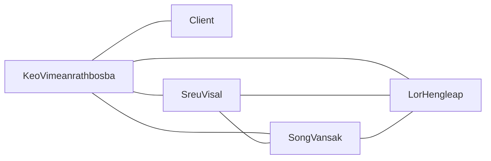

# Communication overhead · clubhub-ITC-4G (v1.0, 10/21/2026)

## Paths

| Model                 | People n | Paths n(n-1)/2   | Minutes/week | Hours/week |
| --------------------- | -------- | ---------------- | ------------ | ---------- |
| (a) everyone + client | 5        | 5(5-1)/2=10      | 10x10 = 100  | 1.666      |
| (b) client via PO     | 4        | 4(4-1)/2 + 1 = 7 | 7x10 = 70    | 1.1666     |

Assumption: 10 minutes per path per week, because each communication path requires time to exchange updates, clarify requirements, and resolve misunderstandings.
Team capacity: 4 members × 2 h = 8 h/week. 
-> model (a) costs 1.66 / 8 x 100 = 20.83% of weekly team capacity.
→ model (b) costs 1.166 / 8 × 100 = 14.53% of weekly team capacity.

## Our paths (model b)

## Two practices

1. 10-minute stand-up, three times a week. Each member briefly reports progress, blockers, and their next task. Bosba collects client-related questions and shares the answers with the team. This replaces scattered status updates with three short meetings, costing approximately 0.5 h/week in scheduled meeting time. We will keep updates brief and move detailed discussions to GitHub Issues.

2. GitHub Issues as the single source of truth. We record requirements, decisions, bugs, and task owners in GitHub Issues instead of repeatedly explaining the same information in private messages. This reduces the assumed cost per path from 10 to 6 minutes per week. Model (b) then costs 7 × 6 = 42 minutes, or 0.7 h/week. This saves approximately 0.47 h/week compared with the original model.

## A sixth member in week 11

With six team members and the client communicating only through the PO:

Path n(n-1)/2 = 6(6-1)/2 + 1 = 16

The overhead rises from 7 to 16 paths, an increase of (16-7)/7 × 100 ≈ 128.6%. At 10 minutes per path, that is 160 minutes or 2.67 h/week.

Decision: We would not accept the sixth member in week 11 unless the additional person has a clearly defined role that provides enough benefit to justify the onboarding and coordination costs, consistent with Brooks's law.

## Reflection: the essential difficulty we expect first
Reflection

The essential difficulty that our team is most likely to encounter first is changeability in ITC Club Hub. As we navigate ITC Club Hub, it is completely expected of us to get confused especially with the rapid transformation demands from the client. For demonstration, the rules for importing club data may initially require only a club name and capacity. However, the client may want to add other fields such as category, meeting schedules and so on. These abrupt requests of change can affect the CSV format, validation rules, C++ classes, and tests. 

For the next four weeks, our team will be on guard and prepared with the rapid request of changes from the client by recording issues that lie in GitHub, while making sure we have the confirmations made by the Product Owner and the client. We will also work on our collaboration skills within our team ensuring that we communicate well from Product Owner to Scrum Masters to Developers. The quality of our work will improve as anticipated as we learn to work together.

# Signed Members Statement

- Song Vansak (Scrum Master): I will organize the short team check-in, focusing more on communication, progress, GitHub issues.
- Lor Hengleap (Developer 1): I expect to find more bugs than planned especially when integrating , so i will test each feature before adding to the system.
- Sreu Visal (Developer 2): I will test my code regularly, read error messages carefully, and fix problems as soon as they appear.
- Keo Vimeanrathbosba (Product Owner): I will be checking in with the client to make sure we can give them what they ask for and what they really want. Additionally, I will work well with my team.